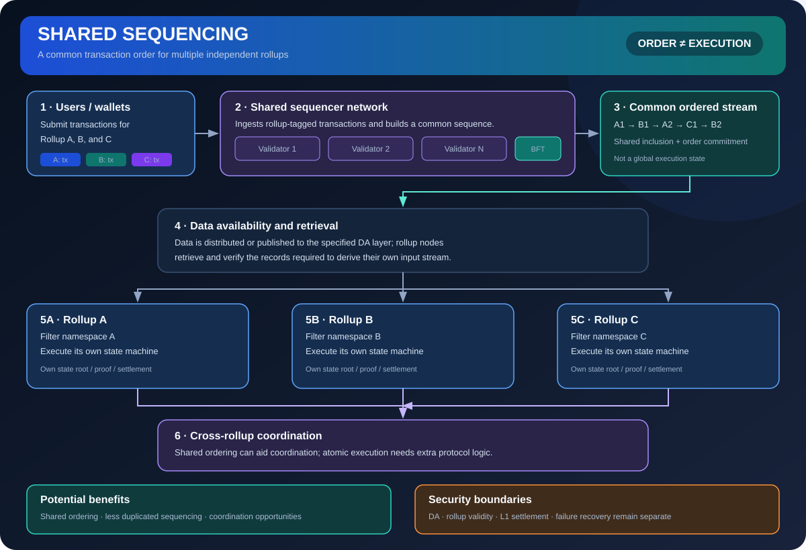

# Shared Sequencing: Coordinating Transaction Order Across Rollups

> **Stage:** 07 — Advanced Layer 2 and Cross-Chain  
> **Priority:** 3  
> **Status:** Reviewed  
> **Last reviewed:** 2026-10-18

## 1. Overview

Shared sequencing is an architecture in which one sequencing system or coordinated network orders transactions for multiple rollups. Instead of each rollup relying solely on its own independent sequencer, participating chains may receive related ordering commitments or coordinated inclusion from shared infrastructure.

## 2. Why It Matters to a Developer

Shared sequencing can make cross-rollup composability and coordinated execution easier to build, particularly when applications depend on operations across two L2s. However, it also introduces a new protocol boundary: participating rollups must decide what to trust about ordering, inclusion, liveness, and how shared commitments are enforced.

## 3. How It Works

1. Rollups or users submit transactions to a shared sequencing network under its message and fee rules.
2. The shared system selects and orders transactions for one or more participating rollups.
3. It publishes signed commitments, certificates, or other outputs representing the chosen sequences, depending on the design.
4. Each rollup verifies and incorporates the shared result according to its local rules and settlement framework.
5. Applications may use a shared ordering guarantee to coordinate actions, but actual cross-chain execution still depends on destination-chain processing, finality, and failure handling.

There is no single universal shared-sequencer protocol. For example, Astria documents a design in which a decentralized sequencer network uses CometBFT consensus to order transactions tagged with a rollup identifier, with rollup execution and data publication handled by separate components. Other designs make different choices. Shared sequencing should also be distinguished from a based rollup: a based rollup derives its sequence from the L1 proposer path, whereas a shared sequencer is a separate ordering system used by multiple participating rollups. Systems differ in validator sets, quorum rules, slashing, inclusion guarantees, DA architecture, and integration requirements.

## 4. Example or Experiment

A lending app on Rollup A and a collateral app on Rollup B may prefer a coordinated order for two transactions. Shared sequencing can make the ordering relationship more explicit, but it does not automatically make the pair atomic. The app still needs a protocol for partial execution, delayed destinations, reverts, and asset safety if only one chain completes the relevant action.

## 5. Common Mistakes and Security Considerations

A shared sequencer can become a cross-rollup failure domain: censorship, downtime, compromised quorum keys, or faulty commitments may affect many chains at once. A signed ordering certificate proves only what the shared protocol specifies and must be checked against a clear trust model. Avoid claiming 'atomic composability' unless the protocol actually guarantees the required atomic execution semantics.

## 6. Key Takeaways

- Shared sequencing coordinates ordering across multiple rollups; it is not identical to shared settlement.
- Cross-chain coordination does not by itself guarantee atomic execution or destination finality.
- Assess quorum assumptions, censorship/liveness paths, slashing, decentralization, and correlated failure risk.

## 7. References

- [Astria Docs — Introduction](https://docs.astria.org/overview/introduction)
- [Astria Docs — Sequencing Layer](https://docs.astria.org/overview/components/the-astria-sequencing-layer)
- [Ethereum.org — Bridges](https://ethereum.org/developers/docs/bridges/)
- [Based Rollups — Superpowers from L1 Sequencing (Ethereum Research)](https://ethresear.ch/t/based-rollups-superpowers-from-l1-sequencing/15016/1)
- [L2BEAT — Risk Analysis](https://l2beat.com/scaling/risk)
