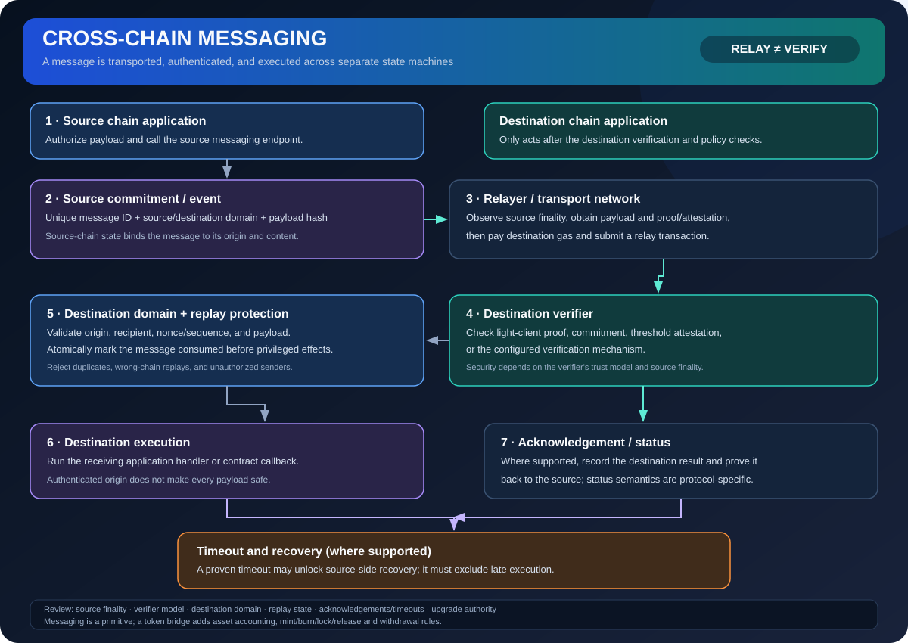

# Cross-Chain Messaging: Authenticated Calls Between Networks

> **Stage:** 07 — Advanced Layer 2 and Cross-Chain  
> **Priority:** 3  
> **Status:** Reviewed  
> **Last reviewed:** 2026-10-18

## 1. Overview

Cross-chain messaging lets a contract on one blockchain send a message or request that a contract on another blockchain can execute. A messaging protocol must transport the message and provide a destination-side way to authenticate that it was emitted by the expected source, reached the required finality, and has not already been executed.

## 2. Why It Matters to a Developer

Cross-chain dApps are distributed systems running across independent consensus domains. A message can be delayed, duplicated at the transport layer, censored, or delivered after a source-chain reorganization. Smart-contract developers must design for asynchronous delivery and explicit trust assumptions rather than assuming one globally atomic transaction.

## 3. How It Works

1. A source contract emits or records a message containing a source domain, destination domain, sender, recipient, payload, and unique identifier/nonce as appropriate.
2. A relayer or messaging network transports evidence of the source event or state.
3. A verifier on the destination checks source-chain finality and the protocol's authentication mechanism, such as a light-client proof or a validator/oracle threshold.
4. The destination contract validates the message's source, destination, payload format, and replay status.
5. The destination application executes the request and records it as consumed; failures and retries are handled according to the protocol.

A relayer can be untrusted for message integrity only when the destination independently verifies suitable evidence. A relayer may still affect liveness if it is the only actor willing or able to deliver a message.

## 4. Example or Experiment

A source-chain contract requests that a destination lending contract release collateral. The destination must not accept arbitrary bytes from a relayer: it should rely on the bridge's verifier, restrict the allowed source chain and source contract, check message identity, and mark the message consumed before making an external state-changing call. If destination execution reverts, retry behavior must not cause duplicate release.

## 5. Common Mistakes and Security Considerations

Replay attacks, forged source events, weak validator thresholds, reorgs, incorrect domain IDs, reentrancy, and asynchronous partial failure are common design hazards. Never rely on a source contract's self-reported `chainId` alone as proof of cross-chain origin. A message's security is bounded by the source and destination finality assumptions plus the bridge/messaging verifier and its administration.

## 6. Key Takeaways

- Message transport and message authentication are separate responsibilities.
- Use domain binding, source-contract allowlists, unique message IDs, and replay protection.
- Design for asynchronous execution, retries, reorg handling, censorship, and partial failure.

## 7. References

- [ERC-7786 — Cross-Chain Messaging Gateway](https://eips.ethereum.org/EIPS/eip-7786)
- [Ethereum.org — Bridges](https://ethereum.org/developers/docs/bridges/)
