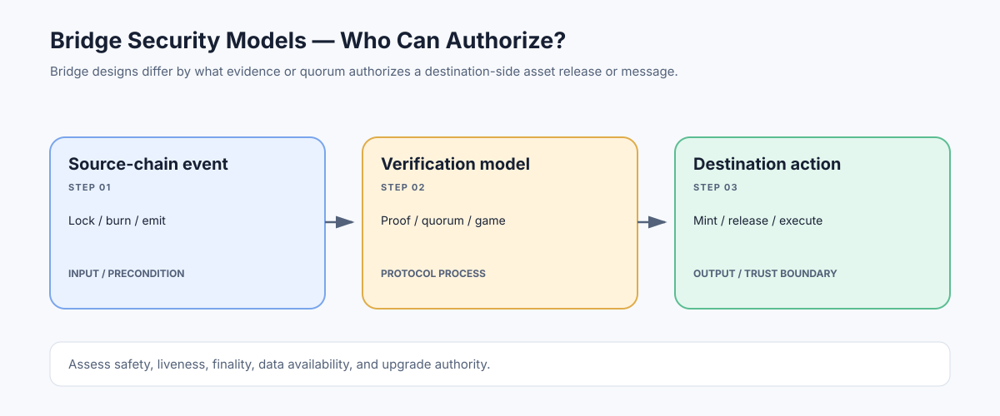

# Bridge Security Models: Understanding What Secures Cross-Chain Transfers

> **Stage:** 07 — Advanced Layer 2 and Cross-Chain  
> **Priority:** 3  
> **Status:** Reviewed  
> **Last reviewed:** 2026-10-18

## 1. Overview

A bridge security model describes how one chain decides that a statement about another chain is trustworthy enough to release assets or execute a message. Designs range from canonical rollup contracts that rely on the rollup's settlement rules, to light-client verification, optimistic dispute systems, external validator committees, oracle attestations, and liquidity networks.

## 2. Why It Matters to a Developer

Bridges concentrate value and connect chains that have independent consensus, execution, and upgrade controls. The most important security question is not simply whether a bridge has been audited, but which parties or cryptographic mechanisms can authorize a release, and what happens when those assumptions fail.

## 3. How It Works

Common models include:

- **Canonical rollup bridge:** relies on the rollup's L1 contracts, commitments, proof/fault-proof rules, and withdrawal process.
- **Light-client or on-chain proof verification:** destination logic verifies source-chain consensus/state evidence, shifting complexity into client and proof verification.
- **Optimistic verification:** accepts a claim provisionally and allows a challenge period with an authenticated dispute process.
- **External validator or multisig committee:** a threshold of external signers attests to cross-chain events; safety depends on threshold, key security, and independence.
- **Liquidity network:** a provider pays out on the destination before or without a direct canonical message flow, then later rebalances; liquidity and provider risks become important.

Some bridges combine these mechanisms, and labels such as 'native' or 'trustless' do not replace reading the actual contracts and verification path.

## 4. Example or Experiment

For a lock-and-mint bridge, ask what evidence lets the destination mint a wrapped token. If a 5-of-9 committee can sign that a deposit occurred, the critical question includes whether five keys can collude or be compromised and whether the destination contract verifies the exact source event, asset, amount, recipient, and unique deposit ID. An L1-verifiable proof changes the trust assumptions but introduces its own correctness and upgrade risks.

## 5. Common Mistakes and Security Considerations

Evaluate safety (can invalid messages release funds?), liveness (can valid messages be censored forever?), finality (when is the source event irreversible?), data availability (can the user get proof inputs?), replay protection, upgrade authority, emergency pause, rate limits, token accounting, and recovery after compromise. A bridge may inherit neither chain's full security if it adds a small external verifier set. Treat admin keys and upgrade paths as part of the bridge's security model.

## 6. Key Takeaways

- Bridge security is defined by the mechanism that authorizes destination actions and its trust assumptions.
- Separate safety, liveness, finality, data availability, and upgrade/governance risks.
- Inspect the verifier path and concrete contracts; do not rely on marketing labels or audits alone.

## 7. References

- [Ethereum.org — Bridges](https://ethereum.org/developers/docs/bridges/)
- [L2BEAT — Risk Analysis](https://l2beat.com/scaling/risk)
- [ERC-7786 — Cross-Chain Messaging Gateway](https://eips.ethereum.org/EIPS/eip-7786)
